# kohaku-frontend-skill

把 [KohakuBlueleaf](https://github.com/KohakuBlueleaf) / [Kohaku-Lab](https://github.com/Kohaku-Lab) 各專案的前端設計邏輯整理成一個 Agent Skill，讓之後的專案都能直接套用同一套 UI/UX 水準。

*English: an Agent Skill that packages the frontend design language of Kohaku-Lab's projects (KohakuTerrarium, Togeari, KohakuNodeIR, TerrariumMarket, Kohaku-Docs, KohakuTUI, …). It covers gemstone accents on warm stone, role-based colour, quiet chrome, no idle motion, separately designed phone layouts and plain copy, and was written from the source, tests and commit history of those projects.*

## 內容

```
.claude-plugin/              Claude Code plugin + marketplace manifest
skills/kohaku-frontend/
  SKILL.md                   核心原則、工作流程、速查表（agent 從這裡開始讀）
  references/
    tokens-and-theme.md      色票規則、角色對應、stone/v2 五層 surface、dark mode、字級 tier
    components.md            按鈕、chip、狀態點、卡片、rail、tab、status bar、設定頁、對話框、表格…
    layout-density-touch.md  殼層類型、density 訊號、手機/觸控規則、overflow、快捷鍵、偏好儲存
    states-and-copy.md       錯誤→載入→空→內容、空狀態、錯誤、連線、文案規則、i18n
    streaming-and-chat.md    聊天/agent 介面、串流 markdown、工具呼叫、捲動、composer
    dataviz-and-canvas.md    圖表配色紀律、儀表板、節點編輯器、文件圖
    docs-and-sites.md        文件站 IA、landing、市集
    terminal-ui.md           CLI / TUI 的同一套語言
    review-checklist.md      交付前檢查表、常見藉口對照
  assets/
    tokens.css               與框架無關的 CSS 變數（single source of truth）
    base.css                 reset、觸控規則、v2 surface、純 CSS 元件 class
    uno.config.js            UnoCSS 設定（Kohaku-Lab 專案用的技術棧）
    tailwind.preset.js       Tailwind preset（取代預設色票）
  scripts/check-palette.mjs  色票檢查：找出 Tailwind 預設色、非法 gem shade、散落的 hex、會一直動的狀態點
  scripts/shots.mjs          截圖（深淺主題 × 桌面/手機），並檢查閒置動畫、橫向捲動、有沒有載入 reset
examples/                    用這個 skill 做出來的四個範例
research/                    六份原始研究筆記（每條規則的出處：檔案:行號、commit）
```

## 安裝

Claude Code（plugin）：

```
/plugin marketplace add treeleaves30760/kohaku-frontend-skill
/plugin install kohaku-frontend@kohaku-frontend-skill
```

直接複製（任何支援 Agent Skills 的工具）：

```bash
git clone https://github.com/treeleaves30760/kohaku-frontend-skill
# 個人層級
cp -r kohaku-frontend-skill/skills/kohaku-frontend ~/.claude/skills/
# 或專案層級
cp -r kohaku-frontend-skill/skills/kohaku-frontend <your-project>/.claude/skills/
# Codex / 其他 runtime 也可以放在 ~/.agents/skills/
```

安裝後，請 agent 做 UI（例如「幫這個專案做一個 dashboard」、「照 Kohaku 風格重做設定頁」、「review 這個前端」）時，skill 會自動觸發。

## 單獨使用 assets

```bash
# 檢查專案的色票是否合規
node skills/kohaku-frontend/scripts/check-palette.mjs path/to/src
node skills/kohaku-frontend/scripts/check-palette.mjs path/to/src --allow src/favicon.js --strict
```

- Vue + UnoCSS：複製 `uno.config.js`，並引入 `tokens.css` + `base.css`
- Tailwind：`presets: [require("./tailwind.preset.js")]`，並引入 `tokens.css` + `base.css`
- 其他：`tokens.css` + `base.css`，使用 `.kt-btn--primary`、`.kt-chip--sage`、`.kt-dot--live`、`.kt-v2-card`…

## 速查

| | |
|---|---|
| 主色 | iolite `#5A4FCF`：唯一的 accent（主要按鈕、焦點、選取、連結） |
| 狀態 | live aquamarine · ok sage · 需要你 amber · 錯誤 coral · 中性 warm，一律搭配圖示或文字 |
| 表面 | light：stone 外框 `#f2eee8` 包住近白 canvas；dark：`#1a1816` 起逐層變亮、卡片無陰影 |
| 字 | Inter + JetBrains Mono；數字一律 mono tabular；字級依「用途」命名 |
| 動畫 | 只有「正在工作」的東西會動，狀態點不動 |
| 手機 | 獨立設計的版面（drawer、tap row、sheet、list→page），不是直接縮小桌面版 |
| 文案 | 句首大寫、動詞按鈕、`…` 進行中、`—` 缺值、`·` 分隔、確認框寫出後果 |

## 來源

| 專案 | 用途 |
|---|---|
| [KohakuTerrarium](https://github.com/Kohaku-Lab/KohakuTerrarium) frontend | 主要來源：token、殼層、聊天/串流、設定頁、色票測試，以及 2700+ commits 裡的設計理由 |
| Togeari dashboard、KohakuNodeIR kir-editor | 較新的方向：v2 surface、圖表配色紀律、節點編輯器互動 |
| KohakuSSHManager、KohakuTPU docs-web | 管理後台模式、閱讀型字級 tier、AGENTS.md 設計契約 |
| TerrariumMarket、Kohaku-Docs、kohaku-lab-home | 市集、文件站、landing 與品牌 |
| KohakuHub、KohakuBoard、KohakuRiver、KohakuPaper | 演化脈絡、資料視覺化（Board） |
| KohakuTUI、KT cli/tui | 終端機語言 |

每條規則的檔案:行號與 commit 出處在 `research/`。

## 驗證方式與前後對照

skill 是照 writing-skills 的 RED → GREEN → REFACTOR 流程寫的。測試題目是一個「GPU job runner」dashboard，需求包含導覽、job 列表、詳細面板、log、表單 dialog、空狀態、斷線狀態、深淺色和手機版。同一題分別交給兩個 agent，一個沒有 skill，一個有。

| | 沒有 skill（baseline） | 有 skill（GREEN） |
|---|---|---|
| `check-palette.mjs` | 51 個錯誤（Tailwind 藍/紅/綠、冷色 slate） | 0 個錯誤、0 個警告 |
| `shots.mjs` 閒置頁面的無限動畫 | 5 個（脈動的狀態點、閃爍的 "Live"） | 0 |
| 表面 | 冷灰、全頁同一層 | stone 外框 + 近白 canvas + 卡片，dark mode 逐層變亮 |
| 手機 | 縮小版表格 | tap rows → 詳細頁、全螢幕 dialog、觸控尺寸 |

有 skill：

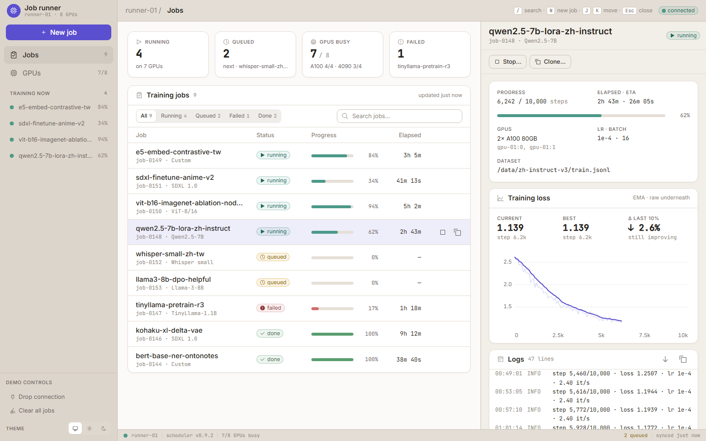
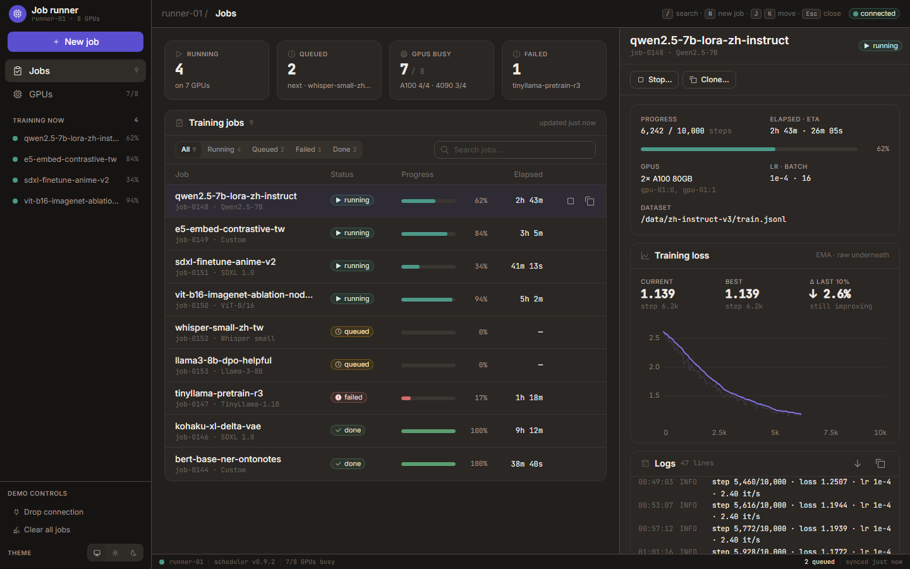

<p>
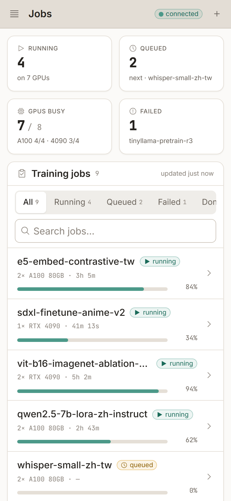
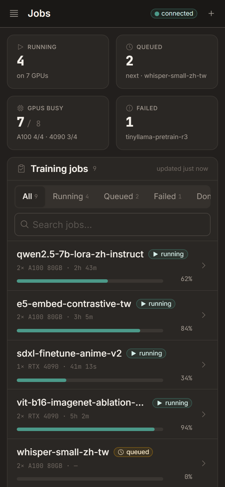
</p>

第二題是 React + Tailwind 的本機 LLM 聊天應用，用來確認 skill 在別的類型和技術棧也能用：

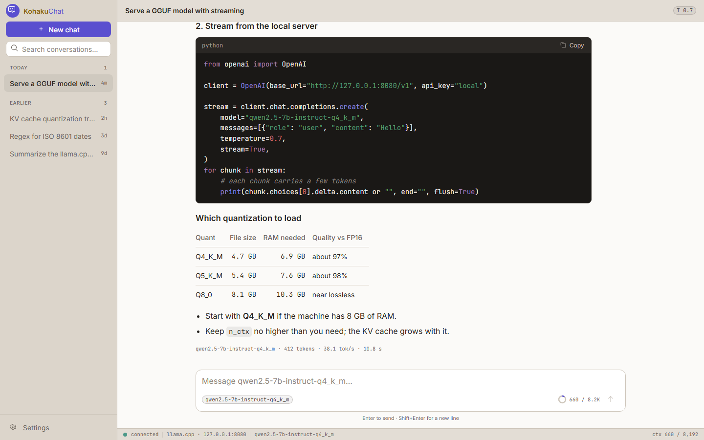
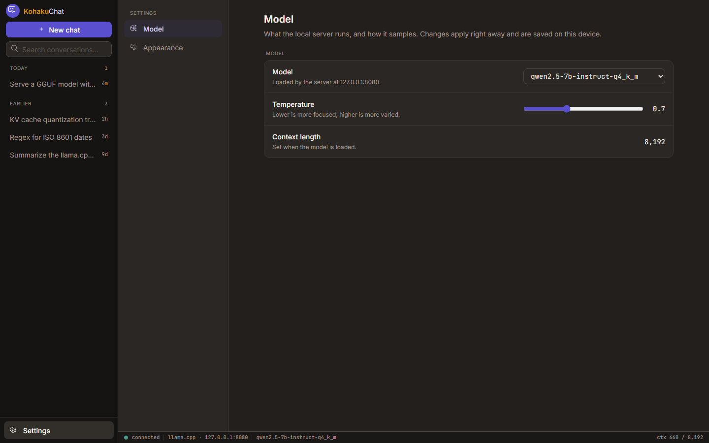

沒有 skill（baseline）：

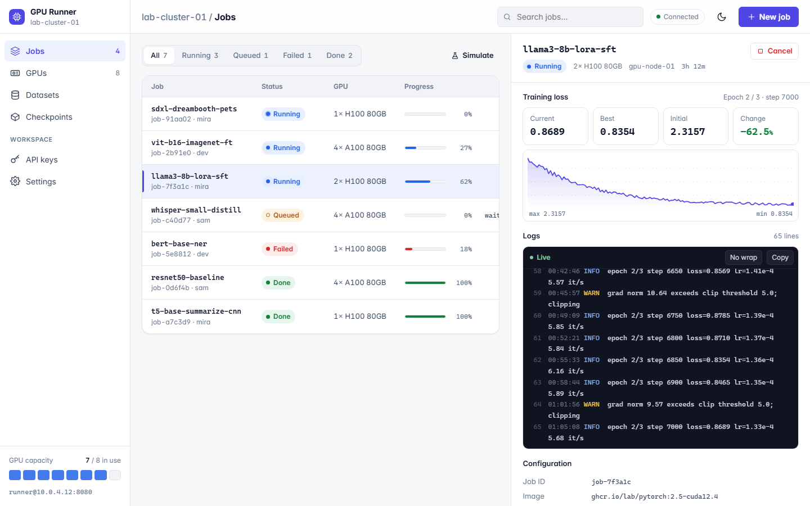

兩輪測試之後，skill 根據 agent 卡住或誤解的地方改過幾處。例如表格欄位改成看容器寬度而不是 viewport，因為側邊面板打開時 job 名稱會被擠成 "e5-e…"；聊天應用那輪則補了深色背景的語法色（用 lifted gem，不用 `-light` 粉彩色）、CJK 區段標籤，以及串流中的表格。

第三題是用 Vite + Vue 3 + UnoCSS 做一個 plugin 市集「Leafpack」，有首頁、瀏覽頁、plugin 詳細頁和文件頁，要有深淺主題和手機版。這題分別交給 Opus 5.5 和 Sonnet 5.5（都是 medium effort），兩邊都只拿到 skill 和需求。

| | Opus 5.5 | Sonnet 5.5 |
|---|---|---|
| `check-palette.mjs` | 0 個錯誤 | 0 個錯誤 |
| `shots.mjs` | 44 張，無自動警示 | 40 張，無自動警示 |
| 四個頁面、四種狀態、深淺主題、手機版 | 都有 | 都有 |
| 沒做的 | command palette、文件頁各欄獨立捲動 | command palette、文件頁各欄獨立捲動 |

Opus 5.5：

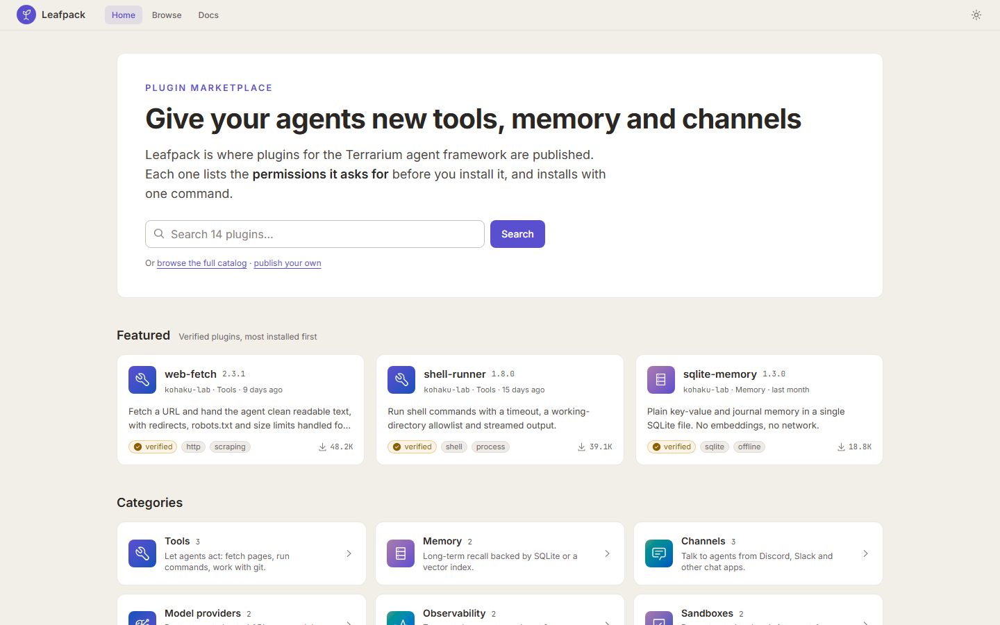
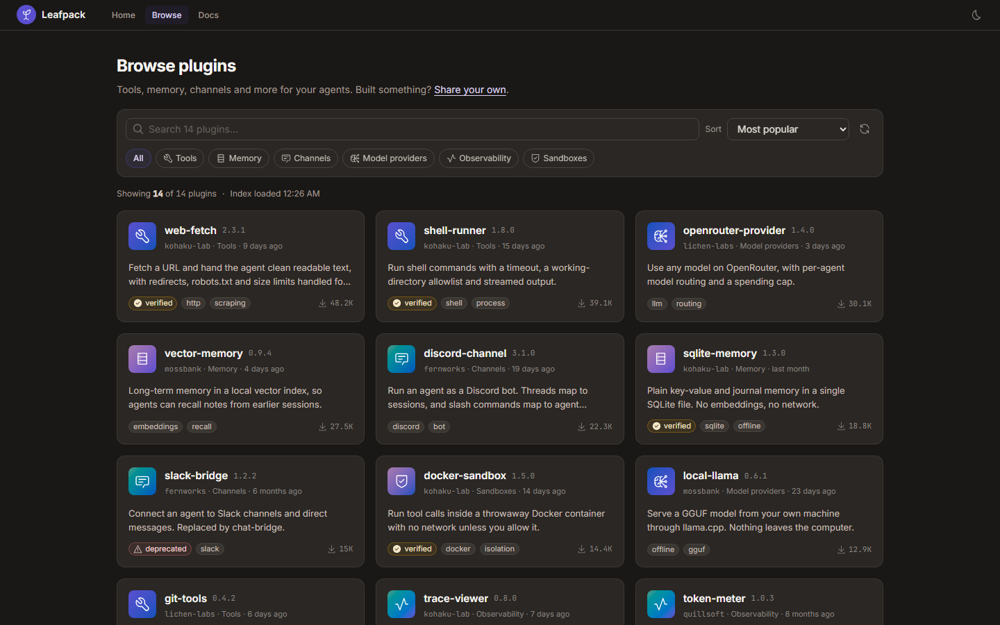
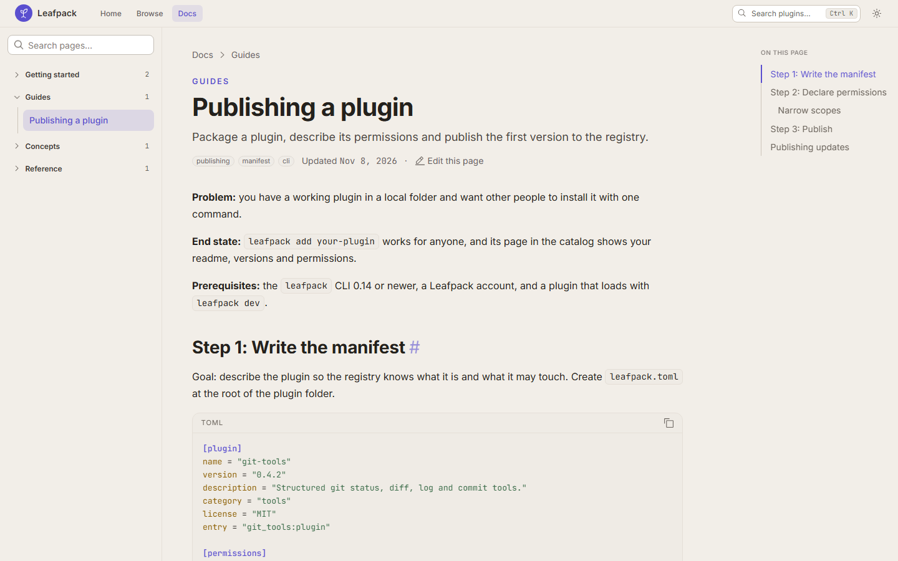

Sonnet 5.5：

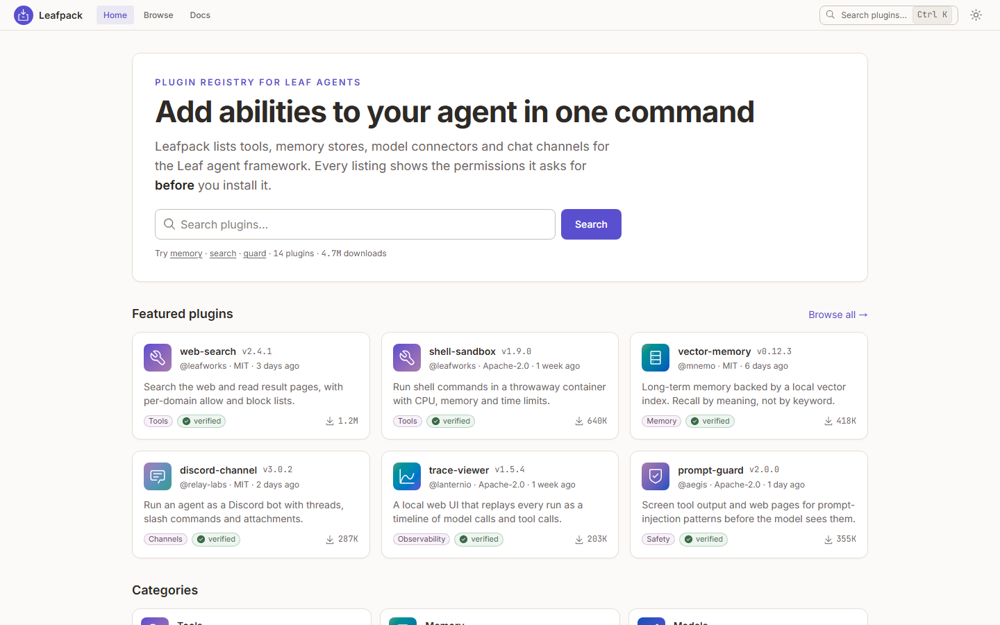
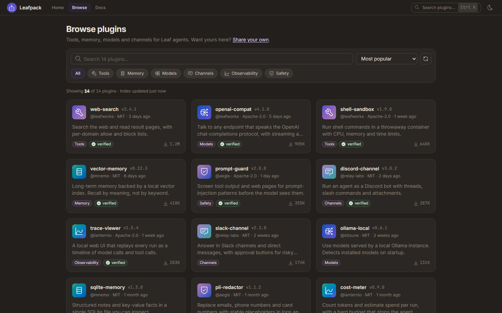
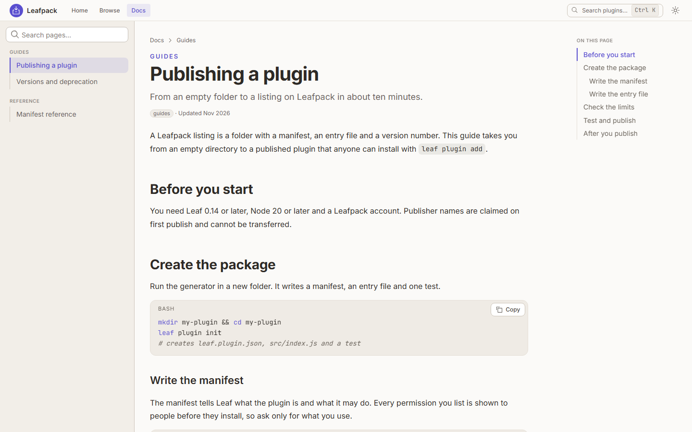

<p>
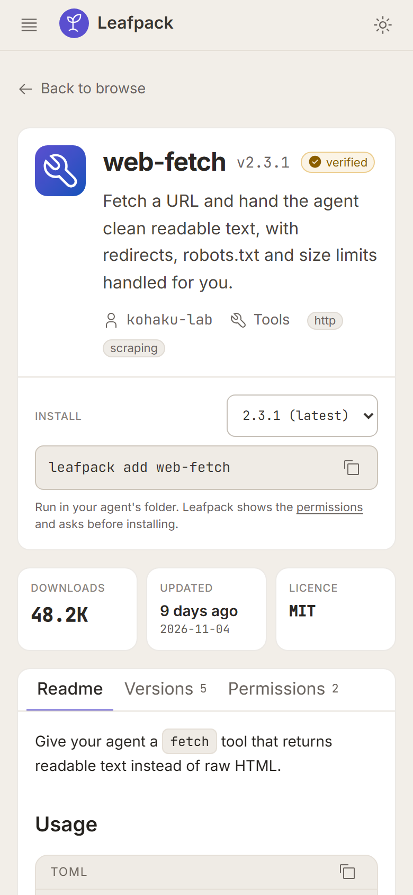
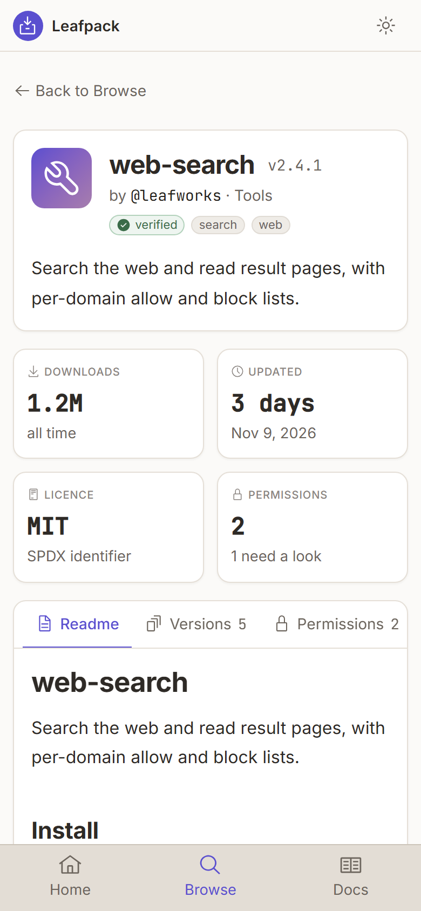
</p>

這一題找到的問題比前兩題多，因為它是第一個真的用 UnoCSS build、而且整頁捲動的專案：

- `base.css` 在 `html` 和 `body` 都設 `overflow-x: hidden`，變成 `body` 在捲，`window.scrollY` 一直是 0，router 的捲動還原和文件頁的目錄高亮都失效。改成 `overflow-x: clip`。
- `button { border: none }` 會讓邊框寬度回到 3px，`border-b-2 border-solid` 的分頁底線變成四邊都有框。`base.css` 現在自己做 reset（邊框、連結、清單、標題），不用再加 `@unocss/reset`。
- 文件頁的內文、code block、callout 原本只有文字說明，兩個 agent 都各自重寫了一份。現在 `base.css` 有 `.kt-prose`、`.kt-code`、`.kt-callout`。
- 載入骨架的寫法和「閒置頁面不能有動畫」互相矛盾，改成靜態的 `.kt-skeleton`。
- `check-palette.mjs` 會對 skill 自己建議的 `text-[11px]` 發警告，現在只在有對應 tier 的尺寸才警告。
- `shots.mjs` 多了三項檢查（`body` 在捲、連結是瀏覽器預設藍、3px 邊框），`--states` 支援 hash 和 history 路由，另外加了 `--full` 整頁截圖。
- verified 和 deprecated 的 chip 顏色原本沒定義，兩個 agent 選的不一樣。現在寫在 `docs-and-sites.md`。

修完後把新的 assets 套回 Opus 那份專案、拿掉它自己加的 workaround，重拍 28 張截圖，自動檢查全部通過。Sonnet 那份保留當時的樣子。

範例原始碼在 [`examples/`](examples/)。

## Token 來源

`assets/` 裡的 token 值和 shortcut 改寫自 KohakuTerrarium、Togeari 的 `uno.config.js` / `style.css`。其餘專案的原始碼沒有收錄在這個 repo。
